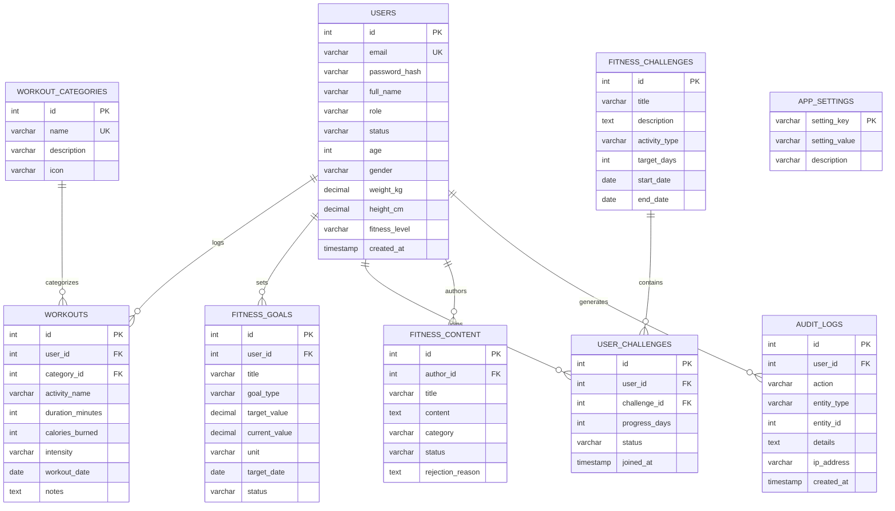

# PulseFit - Online Fitness Tracking Application

PulseFit is a Java web application for recording workouts and tracking fitness progress. It was developed by **General Coders** as a Java Web Technology project.

The application includes member features for workout history, goals, challenges, and fitness recommendations, along with an administrator area for managing accounts, fitness content, application settings, and audit records.

## Technology Stack

- **Language:** Java 17+
- **Web:** Jakarta Servlet 6.0, JSP 3.1, JSTL 3.0
- **Front end:** HTML5, CSS3, JavaScript, Chart.js
- **Database:** MySQL 8.0+
- **Database access:** JDBC and MySQL Connector/J
- **Connection pooling:** HikariCP
- **Password hashing:** BCrypt (`jbcrypt`)
- **Application server:** Apache Tomcat 10.1+
- **Build:** Maven
- **Testing:** JUnit 5 and H2 for selected tests

## Project Structure and Architecture

PulseFit separates request handling, application logic, database access, and page rendering. The main Java packages include `model`, `dao`, `service`, `servlet`, `filter`, and `util`.

```text
Browser
  |
  v
Servlet Filters
  |-- EncodingFilter
  |-- AuthenticationFilter
  |-- AdminAuthorizationFilter
  |
  v
Servlet Controllers
  |-- LoginServlet and registration
  |-- Workout and progress features
  |-- Goals and challenges
  |-- Administrator features
  |
  +----> Service Layer
  |        |-- ProgressService
  |        |-- RecommendationService
  |
  +----> DAO Layer
  |        |-- UserDAO
  |        |-- WorkoutDAO
  |        |-- GoalDAO
  |        |-- ChallengeDAO
  |        |-- ContentDAO
  |        |-- AuditLogDAO
  |                  |
  |                  v
  |            HikariCP / JDBC
  |                  |
  |                  v
  |                MySQL
  |
  +----> AsyncAuditLogger
             |
             v
       Background worker
             |
             v
        Audit log table

Servlet request dispatcher
  |
  v
JSP views using EL and JSTL
```

### Main code responsibilities

- **Models:** Represent application data such as users, workouts, goals, and challenges.
- **Servlets:** Handle HTTP requests and coordinate the requested operation.
- **Filters:** Apply request encoding and access checks before protected requests reach a servlet.
- **Services:** Contain application rules for operations such as progress calculations and recommendations.
- **DAOs:** Keep SQL and database operations separate from servlet code.
- **JSP/JSTL:** Render pages without embedding Java scriptlets in the views.
- **Utilities:** Provide shared functionality such as password hashing, validation, and CSRF token handling.

## Database Design

The schema is defined in `database/schema.sql`; example records are in `database/seed.sql`. The documented entities are listed below. Use the SQL schema as the source of truth for exact columns and relationships.



## Features

### Member features

- **Account access:** Registration, login, logout, and session handling.
- **Workout records:** Create, view, edit, and delete workouts. Records include details such as activity, duration, intensity, date, and notes.
- **Workout search:** Search and filter records by supported criteria, including category, intensity, and date range; sorting is available for supported fields.
- **Progress summaries:** View workout totals and activity charts, including daily duration and category breakdowns.
- **Fitness goals:** Set targets and view calculated progress toward them.
- **Challenges:** Browse challenges, join or leave them, record progress, and view challenge history.
- **Recommendations:** Receive suggestions generated by application rules based on workout activity and goals. These suggestions are not medical advice.
- **Profile:** Update profile information and change a password after verifying the current password.

### Administrator features

- Search and manage user accounts, including account status and roles.
- Review and moderate fitness content.
- Manage challenges and application settings.
- View platform summaries.
- Review audit records, with filters for the available event fields.

## Security and Request Handling

The codebase includes the following security-related components:

- **BCrypt:** Passwords are stored as password hashes rather than plain text.
- **Prepared statements:** JDBC queries use parameterized values to reduce SQL injection risk.
- **CSRF protection:** `CsrfUtil` provides tokens for state-changing requests.
- **Output escaping:** Validation utilities and JSTL output escaping help prevent unsafe HTML from being rendered.
- **Authentication and authorization filters:** `AuthenticationFilter` checks authenticated access, while `AdminAuthorizationFilter` protects administrator routes.
- **Session handling:** Session regeneration is used during authentication to help prevent session fixation.
- **User data isolation:** Data-access operations should scope member-owned records to the current user.
- **Application shutdown:** `AppLifecycleListener` manages the shutdown of shared resources such as the connection pool and audit worker.

These components should still be tested in the intended environment before the application is exposed publicly.

## Asynchronous Audit Logging

`AsyncAuditLogger` uses a producer-consumer approach to write audit events outside the main request path.

```text
HTTP request thread
        |
        | enqueue audit event
        v
BlockingQueue<AuditLog>
        |
        | consumed by worker
        v
PulseFit-AuditLogger-Worker
        |
        | JDBC insert
        v
audit_logs table
```

The implementation uses a thread-safe queue and lifecycle flags to coordinate the worker. `AppLifecycleListener` is responsible for managing the logger during application shutdown. Check the implementation for the queue capacity and shutdown behaviour when changing this component.

## Testing

The repository includes JUnit 5 tests, with H2 used for selected database tests. Test classes cover areas such as:

- `WorkoutDAOTest` — workout data operations and ownership checks
- `WorkoutSearchTest` — search, filtering, and sorting
- `PasswordUtilTest` — password hashing behaviour
- `ValidationUtilTest` — input validation and output sanitization
- `RecommendationServiceTest` — recommendation rules
- `UserTest` — user model calculations and role helpers

Run the test suite from the project root with:

```bash
mvn test
```

Use the command output to confirm the current test result; results may differ as the code changes.

## Project Files

- `src/main/java/com/fitness/` — Java application code
- `src/main/` — web resources and JSP views
- `database/schema.sql` — database schema
- `database/seed.sql` — sample records
- `docs/PROJECT_SPEC.md` — project specification
- `pom.xml` — Maven dependencies and build configuration

## Team

**General Coders**
