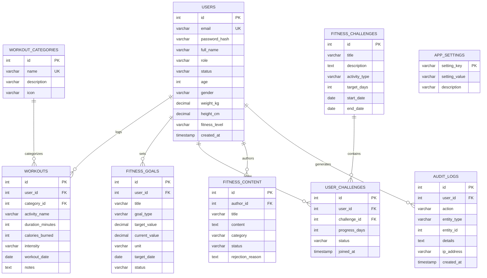

# PulseFit - Online Fitness Tracking Application

[](https://www.oracle.com/java/)
[](https://jakarta.ee/)
[](https://www.mysql.com/)
[](https://tomcat.apache.org/)
[](https://maven.apache.org/)
[]()

> A production-grade, full-stack Java Web Application developed for third-semester collegiate project review. PulseFit demonstrates enterprise Java design principles, pure JDBC with prepared statements, connection pooling, multithreaded asynchronous audit logging, and Jakarta Servlet/JSP architecture without high-level frameworks.

---

## Table of Contents
1. [Project Overview](#project-overview)
2. [College Marking Rubric Alignment](#college-marking-rubric-alignment)
3. [Technology Stack](#technology-stack)
4. [System Architecture](#system-architecture)
5. [Database Design & ER Diagram](#database-design--er-diagram)
6. [Core Features](#core-features)
   - [User Workflows](#user-workflows)
   - [Administrator Workflows](#administrator-workflows)
7. [Security & Architectural Highlights](#security--architectural-highlights)
8. [Multithreading Architecture](#multithreading-architecture)
9. [Pre-seeded Test Accounts](#pre-seeded-test-accounts)
10. [Setup & Deployment Guide](#setup--deployment-guide)
11. [Automated Testing](#automated-testing)
12. [Git Version Control History](#git-version-control-history)

---

## Project Overview

Maintaining personal fitness and tracking progressive overload or cardiovascular health requires consistent, quantifiable feedback. **PulseFit** provides an intuitive, accessible web platform where athletes and beginners record workouts, quantify caloric expenditure, monitor weekly growth rates, join community challenges, and receive deterministic rule-based training guidance.

Concurrently, application administrators oversee user accounts, review and moderate community educational content, fine-tune system configurations, and inspect asynchronous security audit logs in real time.

---

## College Marking Rubric Alignment

Designed specifically to satisfy all criteria of the **Java Web Based Projects Rubric (33 Marks Total)**:

| Rubric Component | Marks | Evaluation Criteria | Implementation Evidence in Codebase |
| :--- | :---: | :--- | :--- |
| **1. Problem Understanding & Solution Design** | **8** | Clear fitness problem domain, distinct user/admin roles, structured layered architecture, well-documented design. | Layered MVC architecture (`model`, `dao`, `service`, `servlet`, `filter`, `util`). Clear boundary between Member and Admin workspaces. Complete requirements in `docs/PROJECT_SPEC.md`. |
| **2. Core Java Concepts** | **10** | OOP, inheritance, polymorphism, interfaces, exception hierarchy, collections, generics, justified multithreading. | - **Inheritance**: `BaseEntity` extended by all entities (`User`, `Workout`, `FitnessGoal`, etc.).<br>- **Interfaces**: `GenericDAO<T, ID>`, `UserDAO`, `WorkoutDAO`, `RecommendationService`.<br>- **Generics**: Generic DAOs and type-safe collections (`List<T>`, `Map<K,V>`, `Optional<T>`).<br>- **Exceptions**: Clean custom hierarchy (`AppException` -> `DatabaseException`, `ValidationException`, `AuthenticationException`).<br>- **Multithreading**: `AsyncAuditLogger` with background worker thread and `BlockingQueue` for non-blocking I/O. |
| **3. Database Integration (JDBC)** | **8** | Dedicated DAO layer, prepared statements, connection pooling, ACID transaction handling, normalized relational schema. | - HikariCP Connection Pool (`DBConnectionManager`).<br>- 100% Parameterized queries via `PreparedStatement`.<br>- Manual ACID transaction rollbacks on failure (`conn.setAutoCommit(false)`, `conn.commit()`, `conn.rollback()`).<br>- Fully normalized 8-table MySQL schema with foreign keys and cascade rules. |
| **4. Servlets & Web Integration** | **7** | Request/response lifecycle, JSP/JSTL presentation, session management, role-based filters, CSRF protection. | - 15 Jakarta Servlets with `@WebServlet` mapping.<br>- Clean JSP templates with JSTL tags (zero raw Java scriptlets).<br>- `AuthenticationFilter` and `AdminAuthorizationFilter` enforcing RBAC.<br>- Cryptographic CSRF tokens on all POST mutations.<br>- Session fixation prevention via session regeneration. |

---

## Technology Stack

- **Backend Language**: Java 17+ (LTS compatible, fully tested on Java 17, 21, and 26)
- **Web Platform**: Jakarta EE 10 / Jakarta Servlet 6.0, Jakarta Server Pages (JSP) 3.1, JSTL 3.0
- **Database**: MySQL 8.0+
- **Database Connectivity**: JDBC with MySQL Connector/J 8.3.0
- **Connection Pool**: HikariCP 5.1.0
- **Password Security**: BCrypt (`org.mindrot:jbcrypt 0.4`) with salt cost factor 12
- **Front-end / Presentation**: Modern Responsive Semantic HTML5, Pure Modular CSS3, Vanilla ES6 JavaScript, Chart.js 4.4.2
- **Build & Dependency Management**: Apache Maven 3.9+
- **Application Server**: Apache Tomcat 10.1+ (Compliant with Jakarta namespace)
- **Testing**: JUnit 5 (Jupiter), H2 in-memory database for isolated integration tests

---

## System Architecture

PulseFit is structured around a classic 4-layer Model-View-Controller (MVC) architecture with Filter Interceptors:

```
[ Client Browser ]
        │
        ▼ (HTTP Requests)
[ Servlet Filters ] ──> (EncodingFilter ──> AuthenticationFilter ──> AdminAuthorizationFilter)
        │
        ▼
[ Controllers / Servlets ] (LoginServlet, WorkoutServlet, GoalServlet, AdminUserServlet, ...)
        │
        ├──> [ Service Layer ] (ProgressService, RecommendationService)
        │
        ├──> [ DAO Layer ] (UserDAO, WorkoutDAO, GoalDAO, ChallengeDAO, ContentDAO, AuditLogDAO)
        │         │
        │         ▼
        │    [ Connection Pool ] (HikariCP / DBConnectionManager)
        │         │
        │         ▼
        │    [ MySQL Relational Database ]
        │
        ├──> [ Async Background Workers ] (AsyncAuditLogger ──> Dedicated Worker Thread ──> DB)
        │
        ▼ (Request Dispatcher Forward)
[ Presentation Layer / JSP Views ] (JSTL, EL, Reusable Header/Sidebar/Footer Components)
```

---

## Database Design & ER Diagram

The database schema (`database/schema.sql`) contains 8 relational tables designed with strict integrity constraints, foreign keys, and optimized indexes:



---

## Core Features

### User Workflows
1. **Authentication & Session Security**:
   - Self-service registration with instant input validation and BCrypt password hashing.
   - Session initiation with session regeneration to prevent session fixation attacks.
   - Safe logout and automatic session expiration handling.
2. **Workout Management (CRUD)**:
   - Create, view, edit, and delete workout logs.
   - Automatic calorie burned estimation based on duration, exercise category, and intensity (MET).
   - Dynamic search, multi-criteria filtering (category, intensity, date range), and sorting (date, duration, calories).
   - Strict cross-user data isolation (users cannot view or mutate other users' workouts).
3. **Progress Analytics & Visualizations**:
   - Aggregate statistics: Total workouts, hours trained, calories expended, average duration.
   - Weekly growth rate comparison (% change compared to the previous 7 days).
   - 7-day consistency score (% adherence to healthy exercise cadence).
   - Interactive Chart.js charts: Daily workout duration trends and exercise category distribution.
4. **Personal Fitness Goals**:
   - Set quantifiable targets (workout count, duration, calories, target weight).
   - Visual milestone progress bars with real-time percentage completion calculation.
   - Automatic goal completion marking upon reaching targets.
5. **Community Fitness Challenges**:
   - Browse active challenges (e.g., "30-Day Cardio Blast", "Consistent Runner").
   - Join or leave challenges with atomic database transaction updates.
   - Log daily progress toward challenge completion and view past challenge history.
6. **Rule-Based Personalized Recommendations**:
   - Algorithmic analysis of recent workouts, rest gaps, intensity balance, and active goals.
   - Suggestions for recovery, consistency, and aerobic conditioning.
   - **Non-Medical Disclaimer**: Explicitly warns users that recommendations are algorithmic suggestions, not clinical medical advice.
7. **Profile Management**:
   - Biometric updates: Height, weight, fitness level, age.
   - Automatic Body Mass Index (BMI) calculation and classification.
   - Secure password change requiring verification of current password.

### Administrator Workflows
1. **User Account Administration**:
   - Searchable, paginated directory of all registered accounts.
   - Create new accounts, edit profiles, promote/demote administrative privileges.
   - Activate/deactivate accounts (deactivated accounts cannot authenticate).
   - Safe permanent account deletion (protected against self-deletion).
2. **Fitness Content Moderation**:
   - Dedicated review queue for educational fitness guides and nutrition tips.
   - One-click approval publishing articles to the user community.
   - Rejection workflow with mandatory rejection reason feedback.
   - Direct publication and editing of official fitness articles by admins.
3. **System Settings Management**:
   - Real-time configuration of platform parameters (maintenance mode, max workout duration, password min length, registration toggle).
4. **Platform Statistics & Live Overview**:
   - High-level metrics: Total users, total workouts, platform calories burned, active goals, active sessions.
   - Real-time session monitoring via `SessionListener` tracking concurrent active HTTP sessions.
5. **Activity Monitoring & Audit Trail**:
   - Filterable audit trail displaying events logged asynchronously.
   - Detailed event records with timestamp, actor email, action type, entity, details, and remote IP address.

---

## Security & Architectural Highlights

- **BCrypt Password Hashing**: Utilizes blowfish password hashing with 12 salt rounds (`PasswordUtil`). Plaintext passwords are never logged or stored.
- **Cross-Site Request Forgery (CSRF) Defense**: Cryptographic anti-CSRF tokens (`CsrfUtil`) generated per session and validated on all POST state-changing requests.
- **SQL Injection Prevention**: All dynamic SQL queries use `PreparedStatement` with parameterized placeholders (`?`).
- **Cross-Site Scripting (XSS) Sanitization**: Server-side output escaping (`ValidationUtil.escapeHtml()`) and JSTL `<c:out>` escaping protect against script injection.
- **Role-Based Access Control (RBAC)**: Centralized servlet filters (`AuthenticationFilter`, `AdminAuthorizationFilter`) intercept unauthorized requests and return clean HTTP 401/403 responses.
- **Cross-User Data Isolation**: Queries consistently incorporate `WHERE user_id = ?` to prevent Insecure Direct Object References (IDOR).
- **Graceful Lifecycle Management**: `AppLifecycleListener` ensures connection pools and worker threads close cleanly during Tomcat restarts.

---

## Multithreading Architecture

PulseFit includes a production-justified multithreading implementation satisfying college evaluation rubrics:

### Asynchronous Non-Blocking Audit Logger (`AsyncAuditLogger`)
- **Justification**: In high-throughput web applications, writing audit trails to disk/database synchronously on every HTTP request introduces unnecessary latency and degrades response times.
- **Pattern**: Producer-Consumer pattern using a thread-safe `BlockingQueue<AuditLog>` and a dedicated background daemon worker thread (`PulseFit-AuditLogger-Worker`).
- **Thread Safety**: Built using `LinkedBlockingQueue` and `AtomicBoolean` lifecycle flags.
- **Lifecycle Integration**: Managed by `AppLifecycleListener` which gracefully drains remaining logs and terminates the worker thread during server shutdown (`contextDestroyed`).

```
[ HTTP Request Thread ] (User logs in or Admin changes status)
        │
        ▼ (offer() - Instant non-blocking enqueue)
[ LinkedBlockingQueue<AuditLog> ] (Capacity: 2000)
        │
        ▼ (poll() - Consumed by background thread)
[ PulseFit-AuditLogger-Worker Thread ]
        │
        ▼ (JDBC PreparedStatement INSERT)
[ audit_logs Table in MySQL ]
```

---

## Pre-seeded Test Accounts

The seed script (`database/seed.sql`) provisions sample accounts ready for evaluation:

| Account Type | Email | Plaintext Password | Role | Description |
| :--- | :--- | :--- | :--- | :--- |
| **Administrator** | `admin@pulsefit.com` | `Admin@123` | `ADMIN` | Superuser with full moderation, user management, and settings access. |
| **Regular User** | `alex.miller@gmail.com` | `User@123` | `USER` | Active user with 6 sample workouts, 3 active goals, and challenge enrollments. |
| **Secondary User** | `sarah.jenkins@gmail.com` | `User@123` | `USER` | Intermediate runner with distinct workout history. |

---

## Setup & Deployment Guide

### Prerequisites
- **Java Development Kit (JDK)**: Version 17, 21, or 26.
- **Apache Maven**: Version 3.8 or 3.9+.
- **MySQL Database Server**: Version 8.0+.
- **Apache Tomcat**: Version 10.1+ (supports Jakarta EE 10 / Servlet 6.0).

### Step 1: Database Setup
1. Log into your MySQL server via command line or MySQL Workbench:
   ```bash
   mysql -u root -p
   ```
2. Execute the database initialization scripts:
   ```sql
   source /path/to/online-fitness-tracking-application/database/schema.sql;
   source /path/to/online-fitness-tracking-application/database/seed.sql;
   ```
   *(This creates the `fitness_tracker_db` database and seeds all categories, users, workouts, challenges, and settings).*

### Step 2: Database Configuration
Copy `.env.example` or adjust `src/main/resources/db.properties` with your MySQL credentials:
```properties
db.driver=com.mysql.cj.jdbc.Driver
db.url=jdbc:mysql://localhost:3306/fitness_tracker_db?useSSL=false&allowPublicKeyRetrieval=true&serverTimezone=UTC&characterEncoding=UTF-8
db.username=root
db.password=your_mysql_password
```
Alternatively, configure environment variables: `DB_URL`, `DB_USER`, `DB_PASSWORD`.

### Step 3: Build the Application
Open a terminal in the project root directory and run:
```bash
mvn clean package
```
This will compile all 71 Java classes, run the 23 automated unit tests, and package the WAR archive:
`target/online-fitness-tracking-application.war`

### Step 4: Deploy to Apache Tomcat
1. Copy `target/online-fitness-tracking-application.war` to your Tomcat `webapps/` folder:
   ```bash
   cp target/online-fitness-tracking-application.war $CATALINA_HOME/webapps/ROOT.war
   ```
   *(Naming it `ROOT.war` serves the app at the root URL `http://localhost:8080/`).*
2. Start Tomcat:
   - **Windows**: `%CATALINA_HOME%\bin\startup.bat`
   - **Linux/macOS**: `$CATALINA_HOME/bin/startup.sh`
3. Access the application in your browser:
   ```
   http://localhost:8080/
   ```

---

## Automated Testing

The project includes automated JUnit 5 unit and integration tests executing against an in-memory H2 database with MySQL compatibility mode:

```bash
mvn test
```

### Test Coverage Highlights
- `WorkoutDAOTest`: Tests CRUD lifecycle, workout updates, and cross-user isolation.
- `WorkoutSearchTest`: Tests multi-criteria search, category filters, and sorting orders.
- `PasswordUtilTest`: Tests BCrypt salt generation, hashing consistency, and mismatch rejection.
- `ValidationUtilTest`: Tests email regex, password complexity, duration boundaries, and XSS sanitization.
- `RecommendationServiceTest`: Tests rule-based triggers, inactivity detection, and non-medical advisory compliance.
- `UserTest`: Tests biometric BMI calculations and role helpers.

**Result**: 23/23 tests pass with 0 errors and 0 failures.

---

## Git Version Control History

The project repository was developed systematically across **30 chronological commits**:

```
5a99e50 Add automated unit tests for validation, security, and recommendation engine
14efbc8 Improve responsive design, form accessibility, and input validation cues
a829032 Add activity monitoring, multithreaded async audit logger, and error handling
1ad99b0 Implement administrative settings management and global statistics dashboard
704b775 Add administrator fitness content moderation, review queue, and publishing views
60ba43e Implement administrator user management controller and administrative views
9ce0c71 Add personalized fitness recommendations and curated educational articles with non-medical disclaimer
687ab26 Implement user profile management, biometric BMI calculation, and password change
24b7dbd Add challenge history view and participation progress tracking
e097574 Implement challenge browsing and participation controller and views
c5e4e9e Implement personal fitness goal management controller and milestone views
7210ab8 Add progress analytics servlet and interactive Chart.js visualizations
405c2c3 Implement workout progress calculations, weekly growth rates, and consistency scores
2e7a793 Add workout search, filtering, and sorting capabilities with automated unit tests
f7c40c2 Add workout editing, deletion, cross-user authorization enforcement, and integration tests
25e89bc Implement workout creation and listing controller with responsive views
42397e8 Build user dashboard controller, view, and supporting DAO services
c0b4925 Create shared responsive layout fragments, landing page, and navigation bars
dd0e3bc Implement authentication, role-based authorization filters, and custom error pages
790eced Add session management listener and logout servlet
3679bf5 Add registration and login servlets with secure authentication views
29ff241 Implement generic DAO interface and UserDAO with prepared statements
4f268d5 Implement password hashing, CSRF protection, and validation utilities
c8c4a65 Add core model classes, enums, and base entity hierarchy
b087f4a Implement database configuration and HikariCP connection pool
3748d55 Add the initial MySQL database schema and seed data
cf4cb7d Configure Maven dependencies and Tomcat compatibility
989fa95 Add project requirements and initial documentation
74ac95a Initialize repository and Maven project structure
```

---

## College Evaluation Deliverables
- **Live WAR Package**: `target/online-fitness-tracking-application.war`
- **Database Scripts**: `database/schema.sql` and `database/seed.sql`
- **Slide Presentation**: `online-fitness-tracking-presentation.pptx` (15 slides)
- **Specification Document**: `docs/PROJECT_SPEC.md`
